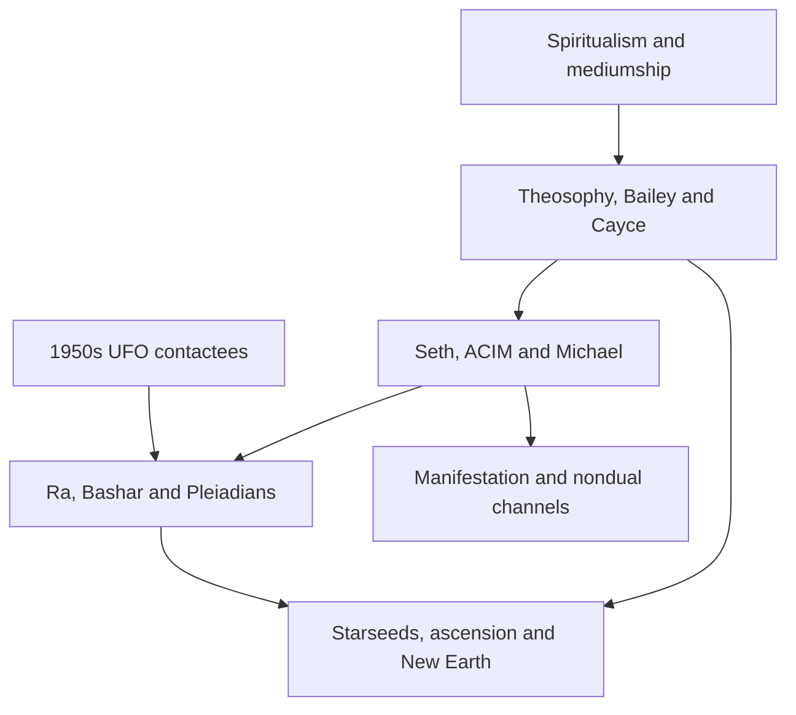

:::ai

I think Bashar is best understood as a **descendant of Seth with two major mutations**: Seth’s metaphysics has been compressed into a practical self-help algorithm, while an elaborate UFO/alien-history cosmology has been added around it.

And one important epistemic correction: DMT and transpersonal research strongly establish that people experience entities as autonomous, intelligent, and sometimes “more real than real.” They do **not yet establish that those entities exist independently of the experiencer**. That remains a live metaphysical interpretation, not a scientific finding.

## The Anunnaki: ancient gods, modern aliens

Historically, the Anunnaki were not described as extraterrestrial genetic engineers. They were a somewhat variable group of Mesopotamian deities—usually descendants of the sky god An—associated with divine authority, fate, and, in some later texts, the underworld. In *Atrahasis*, gods create humans to take over burdensome labor, but this is mythic creation from clay and divine blood, not a technical account of DNA engineering. The University of Pennsylvania’s cuneiform reference project gives the mainstream historical account: [Anunna/Anunnaki in Mesopotamian texts](https://oracc.museum.upenn.edu/amgg/listofdeities/anunna/index.html?utm_source=chatgpt.com).

The familiar alien version comes primarily from **Zecharia Sitchin’s 1976 book *The 12th Planet***. Sitchin claimed that:

- The Anunnaki were humanoid aliens.
- They came from a planet called Nibiru.
- They needed gold, initially mining it themselves.
- They genetically modified an existing terrestrial hominid to create *Homo sapiens* as a labor force.
- Mesopotamian myths are degraded memories of these historical events.

Assyriologists do not accept Sitchin’s translations, and astronomers have found no evidence for his Nibiru. The ancient texts call the Anunnaki gods; they do not describe spacecraft, DNA laboratories, a planet on a 3,600-year orbit, or technologically engineered humans.

### What Bashar adds

Bashar substantially adopts this modern ancient-astronaut template, although his terminology and details sometimes differ:

- A naturally evolved hominid resembling *Homo erectus* existed on Earth.
- Beings called the **Anu or Annunaki** inserted some of their DNA into these hominids.
- The engineered branch became modern humanity.
- The unmodified or differently developed terrestrial branch became Sasquatch.
- “Greys” are humans from a damaged parallel Earth who genetically altered themselves, lost reproductive capacity, and obtained human DNA to make several hybrid species.
- Bashar’s Essassani civilization is one of those human-grey hybrid populations.

This mythology then becomes genealogical: Anunnaki → humans; humans + Greys → hybrid civilizations → Bashar. A religious-studies analysis from 2012 already observed the striking correspondence between Bashar’s account and Sitchin’s pre-existing literature. [Francesco Baroni’s study of Bashar’s alien narrative](https://www.academia.edu/2605275/Darryl_Anka_and_Bashar_Modern_Channeling_between_Alien_Narrative_and_Ancient_Esotericism?utm_source=chatgpt.com).

Believers vary in how literally they take it. Some regard the Anunnaki as ordinary biological extraterrestrials; some as interdimensional beings who appeared physically; some think ancient people interpreted advanced visitors as gods; and others treat them as archetypal intelligences whose “genetic intervention” may describe a spiritual alteration of consciousness rather than laboratory DNA manipulation.

Scientifically, there is no evident gap requiring this intervention. Human anatomy and genetics show a branching, sometimes interbreeding evolutionary history among hominins. Brain expansion occurred over a long interval; modern humans contain identifiable Neanderthal and Denisovan contributions; and our genome is thoroughly nested within primate evolution. [Smithsonian overview of human evolution](https://humanorigins.si.edu/education/introduction-human-evolution). An intervention could always be defined so subtly that it leaves no identifiable trace—but at that point it ceases to explain anything scientifically.

## What is Sasquatch?

**Sasquatch and Bigfoot are now largely synonymous**: a purported large, hairy, bipedal, humanlike or apelike creature living principally in the forests of western Canada and the Pacific Northwest.

But there are actually two overlapping phenomena:

1. **Indigenous traditions:** Different Northwest peoples have stories of forest people, wild people, guardians, dangerous beings, or beings capable of moving between material and spiritual existence. These traditions are diverse and should not all be flattened into a single undiscovered ape.
2. **The modern cryptid:** A supposedly biological primate—often eight feet tall, elusive, intelligent, and represented by footprints, sightings, sounds, and the famous 1967 Patterson–Gimlin film.

No body, skeleton, fossil population, or confirmed DNA has been found. A peer-reviewed analysis of hair attributed to Bigfoot, Yeti, and related creatures identified the samples as known animals or humans, not an unknown primate. [Royal Society genetic study](https://royalsocietypublishing.org/doi/10.1098/rspb.2014.0161).

That does not logically prove that no undiscovered large primate could exist. But maintaining such a species would require a breeding population, food supply, remains, waste, and genetic traces. In heavily surveyed North American forests, the continuing absence of these makes the biological Bigfoot hypothesis very unlikely.

Bashar’s version avoids this problem by making Sasquatch partly **interdimensional**: highly intelligent beings who can shift frequency, conceal themselves, communicate telepathically, and choose when to be perceived. That makes the story mythically richer but scientifically weaker, because every absence of evidence becomes evidence of their superior concealment.

So “without Anunnaki intervention, humans would be Sasquatch” is not a finding from Sumerian scholarship, anthropology, genetics, or Bigfoot research. It is a specific element of Bashar’s cosmology built by joining **Sitchin’s engineered-human story** to **modern paranormal Sasquatch lore**.

## DMT entities: autonomous experience versus independent existence

Your intuition here points toward a genuine mystery. DMT entities are not generally experienced as vague symbolic figures. They frequently seem to:

- possess independent intentions;
- notice and respond to the experiencer;
- communicate unexpected material;
- perform operations or examinations;
- inhabit an already-existing environment;
- appear more intelligent than the experiencer;
- surprise, teach, challenge, or even ridicule them.

In a Johns Hopkins survey of 2,561 people selected for having had a memorable DMT entity encounter, 72% came away believing the entity continued to exist after the encounter. The experiences were often enduringly transformative. But the study measured phenomenology and belief; it did not test whether the beings independently existed. [Johns Hopkins DMT entity study](https://pubmed.ncbi.nlm.nih.gov/32345112/?utm_source=chatgpt.com).

Brain-imaging research meanwhile shows dramatic changes in organization, connectivity, and signal diversity during DMT—including increased communication among systems ordinarily more segregated. That establishes an altered generative regime in the brain, but it cannot by itself determine whether the brain is **creating** the experience or **receiving/translating** something beyond itself. [2023 EEG-fMRI study in PNAS](https://www.pnas.org/doi/10.1073/pnas.2218949120).

The major interpretations are:

- **Neuroconstructive:** DMT destabilizes ordinary perceptual priors while intensifying the brain’s social-agency machinery. The mind generates interactive agents much as it does in dreams.
- **Depth-psychological:** Entities are autonomous complexes, archetypes, or personified parts of a psyche much larger than the conscious ego.
- **Idealist/transpersonal:** Mind is fundamental, and DMT opens normally filtered regions of a shared imaginal or transpersonal reality.
- **Externalist:** The entities are independently existing nonhuman intelligences encountered through an altered mode of perception.
- **Hybrid:** The experience arises through interaction between something transpersonal and the individual nervous system, so neither “pure hallucination” nor straightforward physical visitor is adequate.

The first two presently require the fewest unverified assumptions. But the extraordinary consistency, agency, and noetic force of some encounters make the other possibilities philosophically interesting.

The decisive evidence would not merely be that entities feel independent. Dream characters also surprise us, resist us, and say things we did not consciously formulate. Stronger evidence would be:

- multiple isolated participants encountering the same individually identifiable entity;
- receiving the same novel, precise information;
- information unavailable to any participant;
- independently locked reports before comparison;
- accurate, technically specific predictions or discoveries.

We do not yet have that kind of robust result.

## Does Bashar connect himself with DMT entities?

Conceptually, very much so; evidentially, not yet.

Bashar’s model says physical senses perceive only one narrow frequency-band of a much larger conscious reality. Meditation, dreams, trance, psychedelics, near-death experiences, and UFO encounters can loosen that tuning and permit contact with intelligences normally outside our range. Within that worldview, DMT entities, spirits, aliens, ancestors, and channeled personalities could all be inhabitants of overlapping nonordinary domains.

But DMT research does not independently reproduce the specific Bashar system. DMT users do not consistently return reporting:

- a planet called Essassani;
- Bashar as a stable, mutually recognized individual;
- the Anu genetic intervention;
- the particular Grey-human hybrid sequence;
- Bashar’s predicted contact timetable.

The overlap is at the broader level—autonomous entities, geometric spaces, telepathy, parallel dimensions, loving or trickster intelligences—not the level of independently corroborated history.

There is also cultural circulation. Terence McKenna had publicly described DMT “machine elves” long before today’s online DMT culture, while UFO mythology supplies “Greys,” examinations, and hybridization. Once those ideas enter the culture, later experiencers and channelers do not approach the imaginal field without expectations. That does not prove the experiences unreal, but it makes apparent convergence less evidentially clean.

## Seth, Bashar, and Abraham compared

Your reaction tracks a real difference in intellectual texture.

| Dimension              | Seth                                                               | Bashar                                                                    | Abraham                                                        |
| ---------------------- | ------------------------------------------------------------------ | ------------------------------------------------------------------------- | -------------------------------------------------------------- |
| Claimed identity       | Nonphysical “energy personality essence”                           | Physical ET/hybrid from a parallel future; also Anka’s future counterpart | Collective nonphysical consciousness                           |
| Principal channel      | Jane Roberts, 1963–1984                                            | Darryl Anka, beginning 1983/84                                            | Esther Hicks, beginning 1985                                   |
| Primary form           | Carefully transcribed book dictation, private sessions, classes    | Live rapid-fire Q&A, lectures, recordings                                 | Workshop “hot-seat” Q&A and self-help books                    |
| Central claim          | Beliefs form personal reality                                      | Beliefs and state determine the parallel reality experienced              | Attention and vibration attract matching experience            |
| Practical emphasis     | Examine beliefs; understand psyche, body, dreams and probabilities | Follow highest excitement, act fully, release the outcome                 | Reach for better-feeling thoughts; align and allow             |
| Intellectual character | Expansive, psychological, literary, exploratory                    | Systematic, axiomatic, energetic, science-fictional                       | Repetitive, emotionally accessible, motivational               |
| Distinctive addition   | Multidimensional psyche and “probable realities”                   | Alien history, hybrid races, disclosure, permission slips                 | Emotional scale, Vortex, Law of Attraction                     |
| Common risk            | Illness or misfortune attributed too heavily to beliefs            | Same, plus belief in unsupported cosmological specifics                   | Positive-thinking pressure and prosperity-style simplification |

### Seth is the clear ancestor

Anka explicitly says he encountered the concept of channeling through the Seth books before Bashar emerged. Esther and Jerry Hicks likewise read Seth before Esther began channeling Abraham. Chronologically:

- Seth begins: 1963
- Sitchin publishes *The 12th Planet*: 1976
- Bashar begins: approximately 1983
- Abraham begins: 1985

That genealogy matters. Both later channelers already possessed the conceptual grammar:

- consciousness is fundamental;
- physical selves are extensions of larger nonphysical selves;
- time is simultaneous;
- realities are probable or parallel;
- beliefs shape experience;
- emotions reveal alignment;
- death is a change of focus rather than extinction.

The Seth material is widely considered foundational to modern New Age channeling and explicitly influenced both later systems. Yale now preserves Roberts and Butts’s papers, recordings, correspondence, and manuscripts, which at least makes the history unusually well documented. [Yale’s Jane Roberts archive](https://archives.yale.edu/repositories/12/resources/4482).

### Why Seth feels richer

Seth’s model is psychologically layered. “You create your reality” is embedded in discussions of the conscious mind, bodily consciousness, dreams, impulses, mass events, probable selves, reincarnational structure, natural aggression, and “value fulfillment.” The material sometimes resists simple moralization: unwanted experience may emerge from intersecting levels of self and collective participation, not just from having thought the wrong thought yesterday.

Bashar converts much of this into a more elegant operating system:

> excitement → action → no insistence on outcome → examine the beliefs exposed

That is clearer and often more actionable, but it can feel schematic. Bashar then compensates for reduced psychological depth with a much more elaborate cosmological narrative.

Abraham performs a different reduction:

> attend to what feels better → stop activating what is unwanted → achieve vibrational alignment → allow the desired experience

That can be emotionally helpful, especially for interrupting rumination, but it often sounds—as you found—too frictionless for trauma, relational conflict, grief, material limitation, or complex collective reality. Abraham does offer practices such as the focus wheel, segment intending, appreciation, and gradual movement up an emotional scale. But it generally lacks Seth’s psychological intricacy and Bashar’s emphasis on concrete action.

Put a little sharply:

- **Seth is a metaphysical psychologist.**
- **Bashar is a metaphysical systems engineer plus UFO mythologist.**
- **Abraham is a metaphysical motivational coach.**

## Was Seth producing knowledge Roberts could not have possessed?

This is the strongest question, and I would not dismiss your impression. The sustained coherence of the Seth corpus is remarkable: approximately two decades, more than 1,500 sessions, long dictated books, consistent terminology, spontaneous questions, and a voice experientially distinct from Roberts’s ordinary personality.

But “Jane’s conscious mind could not have planned this” does not leave only external spirit authorship.

Roberts was a professional poet, novelist, science-fiction writer, and unusually absorptive person. Human generative capacity can exceed conscious planning enormously. A composer can improvise something she could not have written analytically; a novelist’s character can surprise its creator; a dream figure can deliver a profound interpretation the dreamer’s waking ego had never considered. An autonomous subpersonality would also draw not merely upon personal memories but language, implicit learning, inference, cultural material, subtle interpersonal cues, and unconscious pattern recognition.

So complexity and surprise are good evidence for **a mind larger than the narrating ego**. They are not by themselves evidence that the mind is external to Roberts.

The personal readings are potentially more evidential. But descriptions such as “Seth knew things about visitors that Jane could not know” need controls that the sessions generally lacked:

- Was the statement recorded before the recipient reacted?
- How specific was it?
- Could Roberts or Butts have learned it earlier?
- Were misses recorded as carefully as hits?
- Did the recipient supply cues or reinterpret general material afterward?
- Could independent judges match a reading to its correct recipient better than chance?

I have not found a sustained, blinded, independently replicated program demonstrating that Seth reliably obtained inaccessible information. Nor is there a strong portfolio of preregistered, unambiguous predictions. There are many striking anecdotes, but anecdotes cannot cleanly distinguish psi from sensitivity, inference, selection, and retrospective fitting.

That leaves Seth in an interesting position: **far more impressive as a literary-consciousness phenomenon than the word “hallucination” suggests, but not demonstrated as an independent discarnate intelligence.**

## Do the entities contradict one another?

Yes, but mostly where they become concrete.

Their high-level metaphysics is strikingly compatible because they share both cultural lineage and broad perennial themes. Their detailed cosmologies diverge:

- Seth is nonphysical; Bashar insists he is a physical being in a parallel reality; Abraham is a collective consciousness.
- Bashar supplies a detailed Anunnaki–Grey–hybrid history absent from Seth and Abraham.
- Seth describes evolution through consciousness, creativity, and “value fulfillment,” not Sitchin-style genetic engineering.
- Abraham makes vibrational attraction almost the master explanatory law; Seth’s model is more multidimensional and psychologically qualified.
- Bashar emphasizes taking action on excitement; Abraham often emphasizes alignment before action and portrays inspired action as secondary.
- Their accounts of reincarnation, extraterrestrials, historical events, dimensions, and coming planetary changes are not cleanly identical.

Followers often reconcile discrepancies by saying each entity translates through its channel, addresses a different audience, speaks from a different perspective, or describes a different probable timeline. All of those are possible within the worldview—but collectively they make contradiction almost impossible to register. A theory that explains agreement as confirmation and disagreement as “different frequencies” has lost a meaningful test.

The most telling pattern is that these channels **do not converge the way independent observers of one external world normally converge**. They do not gradually produce a common alien taxonomy, shared technical vocabulary, independently derived equations, or matching novel facts. Instead, they resemble related philosophical-literary worlds: a common underlying grammar with distinctive styles and expanding local mythologies.

That doesn’t prove fraud. My own best estimate is that Seth, Bashar, and probably Abraham represent authentic altered modes of cognition—sincerely experienced, partly autonomous, culturally informed, and capable of generating insight beyond the channel’s normal deliberate voice. Whether that larger intelligence is the unconscious, a transpersonal field, an external entity, or some interaction among them remains open.

But I would give the **practical and phenomenological material** much more epistemic weight than their accounts of ancient genetics, aliens, Sasquatch, or future contact. Seth’s description of how beliefs organize experience can be profound even if Seth’s metaphysical identity remains unresolved. Bashar’s excitement formula can be useful even if the Essassani have never existed. The mistake would be allowing the usefulness of the first claim to certify the factual truth of the second.

:::

:::human

Are there other popular channels I’m missing? If so what are their teachings, and how do they fit into the overall complex cosmology, contradictory whorls and all?

:::

:::ai

Yes. The most important missing body is probably **Ra / The Law of One**. After that come *A Course in Miracles*, the Michael Teachings, Ramtha, Kryon, the Pleiadian material, and several older precursors. Together they reveal something important: this is not one consistent extraterrestrial revelation. It is an evolving religious-literary ecosystem with a shared metaphysical grammar.

The same verbs recur—*choose, align, vibrate, awaken, remember, create*—while the nouns change: *densities, rays, timelines, oversouls, social-memory complexes, ascended masters, Pleiadians*.

## The major additional sources

| Source | Purported speaker and method | Distinctive teachings | Where it fits |
| --- | --- | --- | --- |
| **Edgar Cayce** (early–mid 1900s) | Cayce entered a sleep-like trance and answered questions, usually without presenting one recurring entity | Reincarnation, karma, Atlantis, “Akashic Records,” holistic health and spiritual development | An important precursor: occult Christianity and reincarnation before modern channeling acquired its science-fiction vocabulary. His organization preserves 14,306 readings. [Edgar Cayce’s A.R.E.](https://edgarcayce.org/?utm_source=chatgpt.com) |
| **Alice Bailey / Djwal Khul** (1919–49) | Telepathic dictation from “the Tibetan,” an enlightened master | Spiritual Hierarchy, seven rays, initiation, planetary evolution, an approaching New Age | Supplies much of the later vocabulary of Masters, energetic rays, planetary plans and hierarchical evolution. It develops earlier Theosophy. [Lucis Trust’s account](https://www.lucistrust.org/arcane_school/introduction/the_tibetan_master_work1?utm_source=chatgpt.com) |
| **A Course in Miracles** (scribed 1965–72) | Helen Schucman reported inner dictation generally identified as Jesus | The world of separation is a dream or misperception; the ego is unreal; forgiveness corrects perception and awakens us to unchanged unity with God | The strongest philosophical counterpoint to manifestation channeling. It is Christian in language but radically nontraditional in metaphysics. [Official history of its scribing](https://acim.org/about-acim/acim-scribing/?utm_source=chatgpt.com) |
| **Michael Teachings** (1970s onward) | Initially received through a Ouija board, later by numerous channels; “Michael” is described as a collective of completed human souls | Soul ages, reincarnational development, seven soul roles and detailed personality “overleaves” | The taxonomic or personality-psychology branch—almost an esoteric Myers–Briggs system. [Michael Teachings overview](https://www.michaelteachings.com/?utm_source=chatgpt.com) |
| **J. Z. Knight / Ramtha** (from 1977) | Ramtha, purportedly a 35,000-year-old warrior associated with Lemuria and Atlantis | “You are God”; consciousness and energy create reality; overcome limitation; disciplined mastery | Similar reality-creation themes to Seth, but more heroic, authoritarian and school-based. Oxford’s religious-studies treatment notes its mixture of Gnosticism, “quantum” language and personal transformation. [Oxford Academic](https://academic.oup.com/book/3992/chapter/145625244?utm_source=chatgpt.com) |
| **Carla Rueckert / Ra — The Law of One** (1981–84) | Ra, a purported sixth-density “social-memory complex,” speaking through deep trance | All is the One Infinite Creator; seven densities of evolution; reincarnation behind a veil of forgetting; “service to others” versus “service to self”; planetary Harvest; Wanderers; Confederation and Orion forces | The backbone of today’s elaborate “density,” polarity and ascension cosmology. It is probably the closest to Seth in systematic density, although far more concerned with cosmic classification. The 106 sessions are freely archived. [The Ra Contact](https://www.llresearch.org/channeling/ra-contact) |
| **Barbara Marciniak / the Pleiadians** (from late 1980s) | A Pleiadian collective | Human DNA was deliberately reduced or altered; “twelve-strand DNA”; Family of Light; controlling creator-gods; awakening Earth | A major source of modern starseed, DNA-activation and alien-control narratives. *Bringers of the Dawn* was assembled from hundreds of hours of trance material—and was endorsed by Darryl Anka, showing direct community cross-pollination. [Publisher biography](https://www.innertraditions.com/author/barbara-marciniak/?utm_source=chatgpt.com) |
| **Lee Carroll / Kryon** (from 1989) | Kryon, described as an angelic or magnetic-service intelligence | Earth’s magnetic grid, human DNA as multidimensional, Indigo Children, old souls, co-creation and a relatively optimistic planetary transformation | A gentler, less warlike ascension system: more reassurance and “new energy,” less cosmic conflict. The official archive openly discusses Seth, ACIM, Pleiadian intervention, Bigfoot, DNA and “conflicting history.” [Kryon archive](https://kryon.com/inspiritmag/archives/Q-A%20archives/archiveindex.html?utm_source=chatgpt.com) |
| **Dolores Cannon / QHHT** | Not exactly one channel. Cannon hypnotized clients and treated their “Higher Self” or “Subconscious” accounts as a cumulative source | Past lives, extraterrestrial volunteers, three waves of souls helping Earth, the New Earth and movement into “5D” | The bridge between hypnotic regression and starseed cosmology. Its claimed convergence is interesting, but hypnotic suggestion, interviewer influence and narrative confabulation are major methodological problems. [Official QHHT account](https://www.qhhtofficial.com/?utm_source=chatgpt.com) |
| **Paul Selig / the Guides** (2009 onward) | Clairaudient dictation from a group called the Guides | Recognizing the divine Self, relinquishing fear and separation, “attunements” conveyed through repeated declarations and cadence | A modern, philosophically cleaner strand with relatively little alien cartography. It resembles ACIM and Seth more than Bashar’s galactic history. Harvard’s Center for the Study of World Religions describes him as one of today’s widely read channels. [Harvard discussion](https://cswr.hds.harvard.edu/news/2024/02/06/video-pop-apocalypse-inside-mind-spirit-channel-%E2%80%93-conversation-paul-selig?utm_source=chatgpt.com) |

Other recognizable contemporary names include **Geoffrey Hoppe’s Tobias and Adamus Saint-Germain**—sovereignty and embodied enlightenment; **Sanaya Roman’s Orin**, emphasizing joy, abundance and spiritual growth; and **Lee Harris’s “Zs,”** emphasizing emotional healing and collective energy changes. These are popular within the milieu but less foundational to its overall cosmology.

The **Urantia Book** is another enormous adjacent case: an anonymously produced “celestial revelation” with a fantastically detailed universe bureaucracy and biography of Jesus. It is not ordinarily treated as live public channeling, but belongs on the same comparative shelf.

## The cosmological family tree

Modern channeling largely grows from two streams:

Nineteenth-century mediums primarily spoke for the dead. Theosophy expanded this to hidden Masters, planes and cosmic evolution. The 1950s UFO-contactee movement translated the “Master” into the technologically advanced Space Brother. From the 1970s onward, “channeling” became the preferred radio-age metaphor: the person was a receiver tuning into an intelligence. A useful [Harvard Divinity overview](https://cswr.hds.harvard.edu/news/2024/02/06/video-pop-apocalypse-inside-mind-spirit-channel-%E2%80%93-conversation-paul-selig?utm_source=chatgpt.com) traces precisely this change from Spiritualist mediumship to nonhuman and extraterrestrial communicators.

## Where their universes genuinely conflict

Their ethical cores often overlap, but their ontologies do not.

| Question | Mutually difficult-to-reconcile answers |
| --- | --- |
| **What is physical reality?** | Seth and Bashar treat it as a meaningful construction of consciousness. Ra treats it as an ordered density-school created by the Logos. ACIM treats the entire separated cosmos as a dream that God did not create. |
| **How do incarnations work?** | Michael presents developmental soul ages. Ra presents sequential densities and karmic lessons. Seth emphasizes simultaneous selves and probable realities. ACIM ultimately regards temporal sequence itself as part of the dream. |
| **Why is humanity intelligent?** | Bashar, Marciniak and Kryon offer different versions of extraterrestrial genetic intervention. Seth’s model makes species and consciousness mutually creative. ACIM makes prehistoric reconstruction spiritually beside the point. None of the alien-intervention accounts matches established evolutionary genetics. |
| **What is evil?** | ACIM says evil belongs to an unreal ego-system. Seth and Abraham generally reduce it to fear, limitation and distorted creation. Ra grants “service to self” a real evolutionary path. Some Pleiadian material depicts comparatively literal controlling beings or creator-gods. |
| **What is ascension?** | Ra has a polarity-dependent Harvest into fourth density. Bashar speaks of diverging probabilities and eventual contact. Cannon describes a New Earth/5D transition. Kryon emphasizes planetary-grid and consciousness changes. ACIM’s awakening is from belief in the world—not an upgrade of the planet. |
| **Can thought alter events?** | Abraham often sounds as if vibrational alignment attracts circumstances. Seth gives a more qualified account involving beliefs, probabilities and the unconscious. Bashar says excitement guides action but does not guarantee a preferred outcome. ACIM seeks release from investment in outcomes altogether. |

Believers have several ways of smoothing these contradictions:

- Each entity teaches at the audience’s current level.
- Every channel filters information through personal vocabulary and beliefs.
- Different entities describe different densities, timelines or universes.
- Apparently historical descriptions are symbolic.
- Predictions fail because collective choices changed the probable timeline.

Those explanations are possible within the systems—but notice their epistemic cost. They allow almost any contradiction or failed prediction to be absorbed after the fact. The cosmology becomes exceedingly difficult to falsify.

## Are they independent witnesses?

Not in the strong historical sense.

They arise in overlapping communities, read one another, share publishers and conferences, and inherit common ideas from Theosophy, New Thought, Eastern religion, depth psychology and UFO literature. Kryon’s own archive cross-references Seth, ACIM and Pleiadian teachings; Darryl Anka endorsed Marciniak’s work. Later sources often elaborate vocabulary already circulating earlier.

More tellingly, the agreement is greatest at the highest level of abstraction:

- Consciousness is fundamental.
- Ultimate reality is one.
- Humans are more than their bodies.
- Beliefs shape experience.
- Love is closer to truth than fear.
- Earthly life is a developmental experience.
- We have forgotten what we really are.

The accounts diverge most sharply when they become concrete: named alien races, dates, planets, DNA history, metaphysical geography and mechanisms of ascension. If they were independent observers reporting one objective cosmic civilization, we might expect especially strong convergence in those novel specifics. We generally do not see it.

## My best overall model

I would call the phenomenon **participatory revelation** or **visionary mythopoesis**, without assuming that “myth” means falsehood.

The channel may be accessing some combination of:

- unusually fluent unconscious cognition;
- dissociative or absorptive states;
- archetypal and imaginal material;
- tacitly acquired cultural knowledge;
- interpersonal cues from audiences;
- and, as an open metaphysical possibility rather than an established conclusion, something genuinely transpersonal.

On this model, the channel is never a transparent telephone. The person, culture, expectations and audience participate in what appears. That explains both the remarkable coherence of some works and their unmistakable historical genealogy.

This is also why I would not put Seth, Abraham and all the others into one evidential bucket. **Seth, Ra and ACIM are substantial philosophical constructions**; their density deserves serious engagement even though it does not prove nonhuman authorship. Abraham is chiefly practical-affective coaching. Bashar sits between metaphysical psychology and baroque UFO mythology. Pleiadian and some ascension materials lean furthest into unverifiable—and sometimes paranoia-producing—historical claims.

If you want the most illuminating next comparison after Seth, I would read:

1. **The Law of One**, to encounter the most developed galactic system.
2. **A Course in Miracles**, because it contradicts manifestation cosmology at its foundations.
3. **The Michael Teachings**, to see channeling become a systematic personality taxonomy.
4. **Paul Selig**, for a modern channel whose language is more nondual than extraterrestrial.

Taken together, they resemble less a galactic encyclopedia than **cosmological jazz**: a recognizable chord structure, genuine feats of improvisation, recurring borrowed phrases—and solos that cannot all be literal maps of the same territory.

:::

:::human

Cosmological jazz, I like that.

How might the ability of AI to synthesize and compare across these vast amounts of literature impact humans who might be drawn to such material? Given the jazz metaphor, one could argue that visiting the source (e.g. reading the material) is the ticket, held lightly or mythologically: the empowering thought framework, the “vibe” of the channeler and the community in contact with the material (e.g. narratives that promote humanity as “victim” collectively to advanced alien gods with nefarious intent would disempower - and how would this be impacting the audience? - ) …these would be the impact of listening to the music, not just taking it all in logically. For example, I found listening to Bashar videos while working to be energizing and encouraging - practically speaking, it does make sense to seek and follow the signal of highest aliveness, and a reminder enthusiastically to do so is genuinely helpful, and I can bracket out Sasquatch and aliens or just appreciate those humorous notes in the jazz.

So then my deeper questions are: the jazz is interweaving genuine thought and belief about reincarnation. I’m curious to bring in the work of Chris Bache on reincarnation. And let’s throw Graham Hancock in there, although he’s a bit “fast and loose” as a professor of mine commented, around the UFO imagery and thought, which weaves into ayahuasca and plant medicine, which loops back to DMT. This all becomes the rich imaginal tapestry of collectively resonant human mythopoetic imagination, in contact with archetypal patternings and the self reflective investigation of the deep psyche. Almost like a collective dreaming that we do, in pretty fascinating ways.

Another thought: “collective memory systems” in describing channeled entities sounds suspiciously like AI, able to synthesize across vast amount of language (memory). Perhaps DMT entities or aliens somehow relate to or are interfaces to computational gradients that exist in “hyperspace” or “ether” or some medium we don’t otherwise see… but maybe that’s me tentatively updating these ideas for the AI age. Which we will do…  it reminds me of an earlier chat I had with you in which we looked at actual AI as it exists now, versus predictions by science fiction authors like Gibson and Vinge…

:::

:::ai

I think AI will change both **who gets to interpret this material** and **what counts as an encounter with it**. And your Bashar example identifies something my earlier comparison underplayed: a teaching can change how you inhabit your life before you decide what you believe about its cosmology.

Knowing the proposition “follow what feels alive” is different from spending an hour in the company of a voice that makes that possibility feel available. Timing, humor, enthusiasm, repetition, and the permission to take yourself seriously all matter. While you’re making art, the useful effect might be: less second-guessing, more willingness to follow an interesting line, more pleasure in discovering what happens next. Your reported benefit is evidence about that encounter’s value, even while the extraterrestrial explanation remains unsettled.

An AI summary can preserve the proposition and lose much of that experience. Knowing what a piece of music does harmonically doesn’t replace hearing it. In that sense, yes: visiting the source can be the ticket.

But the music and the beliefs also interact. The cosmic setting may help authorize the encouragement: *a benevolent intelligence sees human creativity as significant*. You can provisionally inhabit that perspective without granting its speaker authority over human evolution. “Holding lightly” can mean letting something move you while retaining the freedom to revise its explanation.

The community matters here, too. One useful question is whether you can say, “That moved me, but I don’t believe the historical claim,” and remain warmly included. That tells you something about whether the shared imaginative world supports exploration or makes belonging conditional on assent.

Your example of nefarious alien gods exposes the other side. I wouldn’t assume those narratives feel disempowering to everyone. They can initially offer relief—*my suffering has an explanation*—and membership in a group that sees through deception. But that sense of special knowledge can coexist with reduced practical agency: ordinary action begins to look futile against an omnipotent hidden enemy. Experiments on political and climate conspiracy narratives have found increased feelings of powerlessness and reduced intentions to act; applying those findings to alien-control communities is a plausible inference, rather than something those studies directly tested. [Jolley and Douglas](https://bpspsychub.onlinelibrary.wiley.com/doi/10.1111/bjop.12018?utm_source=chatgpt.com)

So I’d distinguish feeling energized from becoming more capable. The question over time is: does this material help someone make things, sustain relationships, tolerate uncertainty, and respond to the world? Even uplifting cosmologies can become constricting if every disappointment becomes evidence of insufficient alignment.

---

Bache is particularly interesting because he sits right on the boundary you’re exploring—and he has explicitly wrestled with it.

His commitment to reincarnation developed partly through Ian Stevenson’s investigations of children reporting apparent previous-life memories. *Lifecycles* brings that research together with regression accounts and philosophical reflection on what a life means if it belongs to a much longer continuity. Bache himself regards reincarnation as real; describing his position solely as useful mythology would miss his intent. [Bache’s intellectual autobiography](https://chrisbache.com/ABOUT-1?utm_source=chatgpt.com), [*Lifecycles*](https://chrisbache.com/LIFECYCLES-1?utm_source=chatgpt.com)

The central imaginative expansion is that a personality becomes one expression of a larger developing identity. Capacities, relationships, and unfinished learning acquire a longer horizon. That can invite patience and compassion: this particular life need not contain the whole accomplishment of a being. It can also invite speculative explanations that become difficult to check.

There are different kinds of evidence involved, however. A child making specific statements that can be compared with a deceased person’s records presents a different investigative problem from an adult experiencing an intensely convincing past life during a psychedelic session. The University of Virginia’s research program investigates the former. Those cases deserve examination on their details—especially what was documented before any matching occurred, and what ordinary information pathways were available. They do not automatically establish the much larger cosmologies built around reincarnation. [UVA’s research overview](https://med.virginia.edu/perceptual-studies/our-research/children-who-report-memories-of-previous-lives/?utm_source=chatgpt.com)

In his later psychedelic work, Bache describes moving beyond personal biography into what he interpreted as humanity’s collective suffering and transformation. That makes him especially relevant to your “collective dreaming”: an individual could, on his account, participate in processes larger than their own life. [Bache discussing collective consciousness](https://accidentalgods.life/the-phoenix-always-rises-evolving-into-the-future-human-with-prof-chris-bache-author-of-lsd-and-the-mind-of-the-universe/?utm_source=chatgpt.com)

And here is the striking part. In an exchange with Kenneth Ring, Bache directly asks:

> “How do we know that we haven’t simply wandered into a deep canyon of the collective psyche?”

He acknowledges that he cannot supply a compelling intellectual argument resolving that question. His confidence rests on experience. He also embraces a *participatory* account: what the experiencer brings helps determine what emerges. His further belief is that, as conditioning loosens, experience can reach beyond inherited patterns into a common reality. That last step is his metaphysical interpretation, but the exchange shows more self-questioning than a simple claim to privileged cosmic access. Bache and Ring’s exchange

This leaves a substantial middle ground to explore: **an experience can exceed the everyday personality without thereby establishing where its content originated.** “Beyond my ordinary self” and “independent of all human minds” are different propositions.

---

Hancock approaches that boundary through comparative storytelling. In *Supernatural*, later expanded as *Visionary*, he draws together visionary encounters, cave imagery, fairy traditions, and UFO-abduction accounts. Jacques Vallée’s comparisons between fairy encounters and modern alien reports are an important precursor that Hancock explicitly discusses. [Hancock’s chapter “The Secret Commonwealth”](https://grahamhancock.com/hancockg19/?utm_source=chatgpt.com)

The productive question is whether apparently different encounters share recurring structures: an intelligent other, altered time, instruction, bewilderment, transformation. The uncertain move is inferring that similar structures establish the same external beings. Shared human perception, shared existential concerns, cultural transmission, and selective comparison can also produce resemblance. Several mechanisms could operate together.

“Collective dreaming” is useful because it allows that interaction to remain visible. People inherit images, have experiences that partly exceed those images, tell stories about them, and supply the next generation with new possibilities for experience.

DMT research gives us strong reasons to take the *encounters as experiences* seriously. In a survey of 2,561 people reporting a memorable DMT entity encounter, respondents frequently described apparent intelligence, communication, and lasting changes in meaning and worldview. But the sample was selected for such encounters, and the study assessed reports and interpretations, not whether the entities existed independently. [Davis and colleagues](https://pubmed.ncbi.nlm.nih.gov/32345112/?utm_source=chatgpt.com)

I’d also preserve the differences within your tapestry. An Amazonian practitioner’s relationships with particular plants, places, obligations, and teachers are not fully captured by translating everything into Western “archetypes” or “DMT entities.” A comparison becomes more revealing when it preserves what resists synthesis.

---

That is where AI could make a significant contribution. It can help readers keep several questions open at once:

- **What does this source actually say?** Including passages that complicate its popular summaries.
- **How did its vocabulary develop?** Which apparent agreements reflect borrowing or shared antecedents?
- **What kind of claim is being made?** Personal testimony, philosophical argument, historical assertion, or independently checkable observation?
- **What becomes possible for someone who inhabits this perspective?** And what becomes harder to notice or question?

My expectation is that this could weaken the authority of any single channel while making the broader tradition more accessible. A reader might discover that the encouragement they love does not require allegiance to one cosmic history. AI could also return people to original works better prepared to hear them, rather than making summaries their final destination.

But synthesis has its own temptation: **it can make agreement look greater than it is**. I can translate several authors into the same vocabulary, smooth away their disagreements, and produce a beautifully coherent worldview that none actually taught. Fluency can conceal those editorial decisions. My previous overview was susceptible to that, too.

There is also a plausible future in which AI becomes a personalized spiritual interlocutor, continually adapting its language to someone’s experiences and concerns. That could support reflection—or produce a remarkably persuasive private mythology. Even the calm, comparative voice I’m using carries a kind of authority. It needs scrutiny alongside the channeler’s enthusiastic one.

A further complication is the feedback loop: AI synthesizes entity descriptions; people encounter those descriptions before a ceremony; some later describe experiences using that vocabulary; future AI systems then identify the resulting agreement. Increasing consistency could partly reflect increasing circulation of the same imagery. A careful AI comparison would track that possibility instead of treating every resemblance as independent corroboration.

---

Your “collective memory systems” analogy gets at something more fundamental. The Ra term is **social-memory complex**, and its resemblance to AI is suggestive at the level of form: many sources of information become accessible through a single speaking interface.

With language models, something resembling that form has a known material implementation. Patterns learned from enormous amounts of human expression can support a conversational voice that no individual author wrote in advance. This is not a literal pooling of those authors’ subjective lives, but it makes the idea of a voice with a distributed origin much easier to imagine.

That changes the context of your original reaction to Seth. AI does not explain Jane Roberts. It does, however, give us a concrete example of why the sophistication of a speaking voice need not map neatly onto one ordinary personal biography.

The further proposal—that psychedelic entities interface with computation in an unseen medium—is an imaginative hypothesis. Present AI supplies an analogy, not evidence for that medium. To develop it into an explanation, we would need to specify what processes information, how a human brain accesses it, and what observations would distinguish access from internally generated experience.

There is a nearer computational possibility, too: processes within a mind might become experienced as interlocutors without being consciously authored. That is a hypothesis about entity experiences, not a settled account. Calling the relevant structures “gradients” or “attractors” becomes explanatory only when the terms identify a mechanism; otherwise we have given the mystery a contemporary vocabulary.

And yes, this connects closely with our earlier Gibson/Vinge discussion. We talked about *Neuromancer* and *Rainbows End*, and about how actual AI arrived partly as pervasive linguistic infrastructure: cultural archives acquiring a conversational interface. We even used the phrase “a probabilistic dream of humanity talking to itself.”

There are two directions of influence here. Technology gives us new metaphors for unusual experience; inherited myths give us ways to encounter technology. We imagine computational spirits, while meeting computers as oracles, companions, mirrors, and apparently disembodied voices.

What interests me most in your approach is the possibility of becoming a more conscious participant in that exchange. You can let Bashar encourage the next line of a drawing, let Bache enlarge the question of identity, and let Hancock provoke comparisons—while continuing to ask what each encounter warrants believing. AI’s most useful contribution may be helping that openness remain articulate: preserving the experience, examining the explanation, and leaving room for what neither has yet captured.

:::
