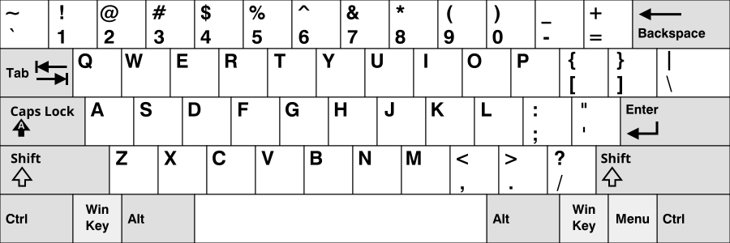
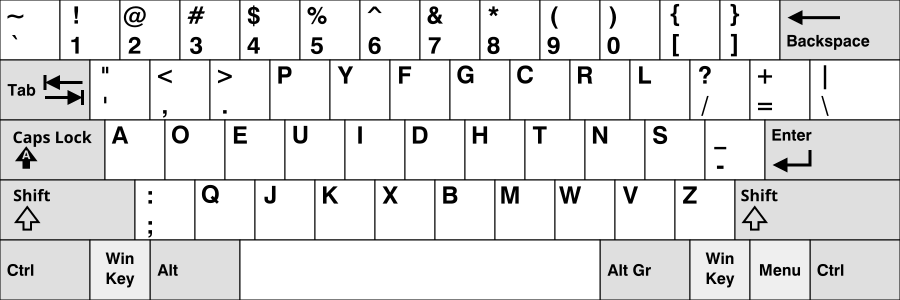

I find myself grateful that in some strange synchronistic prefiguring, I learned the Dvorak keyboard layout in high school. As a result I type comfortably and fast: I'm not as fast as some, but can get up around 90 wpm (haven't tested myself in a while; could be fun to do) and it feels quite good for my hands to type. If you're not familiar with Dvorak, here's the gist, in my own words:

If you've ever wondered why your keyboard goes `QWERTYUIOP` `ASDFGHJKL` `ZXCVBNM` (and yes you should be saying those strings out loud as words, they are quite fun to pronounce! — there was even a book about it I remember, from when I was a kid), basically it boils down to: this key arrangement is not meant to make you type faster or more comfortably. Quite the contrary; there's perhaps apocryphal lore that the top row contains the word `TYPEWRITER` so that traveling typewriter salespeople could give more reliable (one-word, apparently) typing demos, although why they didn't learn to type better with all that time on the road, I'd wonder about. Another idea is that Qwerty (we'll capitalize it as such) is arranged **intentionally to slow you down**, but that's a blunt framing: rather, it's optimal for old mechanical typewriters — meant to put physical distance between oft-adjacently-typed letters, in order to cater to the mechanics where typebars would thwhack an ink ribbon against paper to create letters, and if two typebars positioned next to each other did this too close in succession, they'd both be competing for the same physical "space" and bang into each other like two people trying to sit in the same seat during a game of musical chairs with just one chair left, creating a jam. That eventually stopped being a problem with better mechanical design (and, later, computers), and someone named August Dvorak (DVOR-ak), whose name is not pronounced like the classical composer Antonín Dvořák (DVOR-zhahk), did a solid pass at studying hand mechanics: how the human hand likes to move (e.g., we prefer inward thrumming motions rather than outwards: pinky-to-thumb is easy, but thumb-to-pinky feels less natural), and worked out optimal key layouts which were much better suited to comfortable fast typing. With that, note the following:

*Qwerty. It's probably redundant including this image here because you can just look down at your fingers, but I'm future-proofing this entry in case humanity finally moves on from Qwerty in 500 years. Diagram by Denelson83 via [Wikimedia Commons](https://commons.wikimedia.org/wiki/File:KB_United_States.svg), licensed under [CC BY-SA 3.0](https://creativecommons.org/licenses/by-sa/3.0/).*

1. In Qwerty, only about a third of your typing is on the home row: roughly half is on the top row, requiring a stretch upwards, and the rest is on the bottom row, requiring a cramping downwards, whereas Dvorak has 70% of its typing on the middle (home) row.
2. Dvorak balances the hands between left and right. Qwerty has many words and letter sequences that are typed with one hand alone, whereas Dvorak does much better at not only balancing smoothly between the hands but also alternating keypresses between them.

*Dvorak. Diagram via [Wikimedia Commons](https://commons.wikimedia.org/wiki/File:KB_United_States_Dvorak.svg), public domain.*

Anyway, you can find all the information you want online, about this: [Wikipedia entry on Dvorak](https://en.wikipedia.org/wiki/Dvorak_keyboard_layout). Here's a quick AI summary, courtesy of Claude Fable 5:

:::human
Hello, can you please synthesize a brief articulation of the history and benefits of the Dvorak keyboard, for my blog post?
:::

:::ai
The Dvorak Simplified Keyboard was patented in 1936 by August Dvorak, an educational psychologist at the University of Washington, together with his brother-in-law William Dealey. Where QWERTY had been shaped by the mechanical constraints of 1870s typewriters, Dvorak and Dealey started from studies of letter frequency and the physiology of the hand. The result places all five vowels under the left hand's home row and the most common consonants under the right, so that typing tends to alternate rhythmically between hands, and roughly 70% of keystrokes happen on the home row (versus about 30% for QWERTY). Total finger travel drops dramatically — by most estimates, a Dvorak typist's fingers move less than half the distance of a QWERTY typist's over the same text.

The layout's champions have claimed speed gains, and Dvorak typists have historically been well represented among speed-typing record holders, but the honest summary of the research is that the strongest documented benefits are comfort and reduced strain rather than dramatically faster typing — the famous studies claiming big speed advantages (including a WWII-era Navy study Dvorak himself was involved in) have been criticized as methodologically shaky, and the layout's failure to displace QWERTY is a textbook case study in network effects and switching costs. Still, Dvorak never disappeared: it was recognized as an ANSI standard in 1982 and ships built into essentially every modern operating system, a couple of clicks away for anyone curious enough to endure a few weeks of feeling like a beginner again.
:::

Interestingly, the metric that is quoted is around _speed_, but what I find for myself across a lifetime of working with _expression_ is that speed isn't the most important variable to the exclusion of others; for me it's sustained comfort and ease of getting thoughts from my mind onto the paper. Often this is a journaling endeavor: I don't really seem to be able to think well unless I'm moving my body; my thought process "hangs" and gets frozen into rumination or looping internally, but a linguistic process keeps thought moving, like a plane flying over those sticky terrains so that I can note them, but keep moving. I intentionally use my inner voice when I remember to, or speak aloud (I call it "audio journaling", essentially talking to myself in paragraphs) while driving; the car is an excellent space for such inner defragmentation. But there's something about typing on a computer keyboard that connects rhythmic motions of the body through that expression, and so it becomes integrative: the body is participating in a different way from just using the vocal apparatus, and that itself expands thought through a dance of fingers. I actually notice that when I practice the piano for a while, my typing can get particularly fast afterwards, which shows that music itself unlocks that flow of thought in its own way: perhaps because music is emotional, and thoughts contain emotion; I can think while playing, and those thoughts then move, or go somewhere... expressed simply through the motions of the keys, unlocking the subtle emotional flow that deepens with time, the more I connect with the instrument.

I remember that in high school, we tested one particularly fast typist classmate: he clocked in well over 100 wpm, on Qwerty. I was impressed, because I couldn't get near that via Dvorak. I've seen some really fast Qwerty typists, over time: my own nervous system seems to overwhelm or block, creating pauses between the keystrokes, but fast typists seem better able to access flow. The same thing translates to piano playing, but with practice, and because there is emotion in the music, smoothness arrives as a more holistic endeavor. The more I practice piano, the faster my typing speed ceiling gets — asymptotically, of course. But I use typing to think... so that organizes and declutters my thoughts. Keyboard keys and piano keys are synergistic.

I like Dvorak because it's comfortable and fast. My hands don't get tired. At this point in the development of AI, being able to write clearly and thoughtfully through a keyboard interface is valuable. While speech-to-text is pretty good, there is something about the spaciousness of typing which allows thought to _specify_ more clearly what is desired, although my ideas are shifting about this. Something about typing and seeing text on a screen allows the content to be made more precise, to be edited, to be more real: thoughts, words, fingers, and vision become connected around language. Every communication method seems to be a balance: over the years I've realized that writing by hand is important. It can feel frustratingly slow sometimes, especially if you're a fast typist, and yet the slowness is a feature: the mind cannot get thoughts down at the speed at which they can occur, and so communication spans more thoughts, until an automatic kind of filtering takes place which both slows down the thinking, _and_ surfaces the most emotionally salient thoughts: writing by hand feels more connected to emotion, then, or "is closer to the heart", I've heard it said. The mind slows down; thoughts become more significant.

I don't remember when I picked up this idea from Julia Cameron's book _The Artist's Way_, but her Morning Pages practice is incredibly beneficial. She defines Morning Pages as three pages of longhand, non-stop, stream-of-consciousness writing. Just fill up the pages. I've done this for over a decade... I have piles of notebooks. Morning Pages is a relationship with oneself. I went through years where I _typed_ Morning Pages, but I usually do longhand now; I type sometimes and can compare. Both modes are important. A good typing session clears the mental palate and disentangles some deeply introspective concerns or inner frictions. Handwriting gets more _to the heart of the matter_ and feels like a more productive place to vent anything that needs to be vented. The right tools for a particular day's flow unfold. Sometimes because of the slowness of handwriting I experience resistance in beginning, yet once I settle in, there's satisfaction in filling up those pages.

Back to Dvorak: I'm pretty grateful I picked up this layout, back in high school. I'd read a Letter to the Editor in _Wired_ magazine, extolling the benefits of the layout, and so I configured my computer in software to interpret keypresses according to the Dvorak layout; I printed out a diagram of the layout and stuck it up on the top of my monitor. I was painfully slow for weeks, and almost gave up when I needed to type a final paper. But I stuck with it, and the rest is history: typing is comfortable, fast enough, and feels good to my hands and brain. It's one of those little out-of-the-ordinary things that, today, I look back on with gratitude.

From my journal, yesterday, which inspired this post:

> I'm sitting in Flywheel, the coffee shop near my yoga studio, and have been journaling. I wrote almost 4,000 words: felt very important to help me untangle my thoughts and feel what is happening inside. Some kind of connection opens up with my interior self through writing. I'm actually kind of glad that I left my paper journal at home, because I was able to use the computer to write, and I type fast, and can really unpack and explore ideas and feelings. This makes me grateful that I learned Dvorak, all those years ago... back in high school, actually. The comfortable typing motion with that layout has definitely served me well, and somehow points the direction in this day and age of AI integration with our lifestyles. The fact that it actually feels pretty good to type, aligns with my life in some way that was really prefigured or foreshadowed... what led me to learn that layout, and to really stick with it through the pain points, back when I was in _high school_?
> 
> I read a letter to the editor in _Wired_ magazine extolling the benefits of the layout, and then just switched it in software (Windows 3.1 or something, MS-DOS as well perhaps, if you could do that, I don't remember), printed out a picture of the new layout at the top of my monitor, and got going. Slow at first; pain point when I had a final paper to write and I almost gave up, but I persevered through it and here I am.

Claude conversation:

:::human
Noting that I didn't realize how important writing by hand was, until a few years ago. I did a lot of typed Morning Pages for years, until something unlocked the realization that wait, I need to write this by hand. It almost makes me think about novel writing: what would it be like to initially dream a book with a fountain pen, and how would that differ? Would it be more compressed? Curiosity, there.
:::

:::ai
The compression hypothesis seems right to me, and there's a second effect worth naming alongside it: sentences drafted by hand tend to arrive more _finished_. When the medium can't keep up with the mind, you compose the sentence internally before committing it — a kind of pre-editing that typing doesn't force, because at 90 wpm you can think _through_ the keys and revise as you go. So a fountain-pen draft might be not just shorter but more rhythmically deliberate, closer to how the sentence sounds when spoken. Handwriting is nearer to dictation-to-yourself than typing is.

There's decent company in the experiment, too. Neil Gaiman famously drafts novels longhand with a fountain pen and gives a reason that connects directly to your filtering idea: it makes his first drafts leaner, because writing a sentence by hand is costly enough that he asks whether he actually needs it before spending the ink. He also points out a structural bonus — when you then type it up, the transcription becomes a natural second draft, a full pass through the material with your editor-mind on. That two-stage rhythm (dream it by hand, refine it through the keyboard) maps almost exactly onto your Morning Pages discovery: handwriting for the heart of the matter, typing for the untangling.

The interesting risk, given how your thinking works, is the one you already named — your thought process hangs when it stops moving, and a novel drafted at handwriting speed means a lot of time spent slower than thought. Morning Pages sidesteps this because the form _is_ the slowness; there's no destination to lose. A novel has a destination. So the fountain pen might be best for the dreaming layer specifically — scenes, voices, the compressed seed of a chapter — with the keyboard taking over once the plane needs to actually cover ground. Which might be less a compromise than the natural division of labor your two practices have already been teaching you.
:::

Some more thoughts, as I close this post. I've noticed that _typing on my phone_ brings a slower rhythm that somehow sits between the speed of typing on a keyboard at a computer screen and the slowness of writing by hand. I haven't clocked my thumb-typing speed and don't have a measurement for this, but the convenience of the little hand-held digital devices which can be used lying in bed (difficult to do with a pen and paper) and the distraction-diminishing nature of the small screen give the phone its own unique place in its "medium is the message" positioning as a hyperobject that mediates communication in its own particular way. You can write a novel on the subway, or a school paper sitting in the corner at a rave. You can get your thoughts out of your head with white-on-black text and a dim screen at 4 a.m. when you can't sleep, and more easily fall back asleep or at least feel productive and therefore less anxious or whatever it was that was keeping you up and therefore more likely to fall back asleep, because useful digestion happens through writing. The principle behind Morning Pages and why the practice is effective has a subtlety one can explore and relate to for a lifetime.

Some links: I appreciate the [iA Writer](https://ia.net/writer) app for longer-form writing on the iPhone (writing about some topic, with the intent of sharing it), and I enjoy the [Day One](https://dayoneapp.com/) app for journaling.